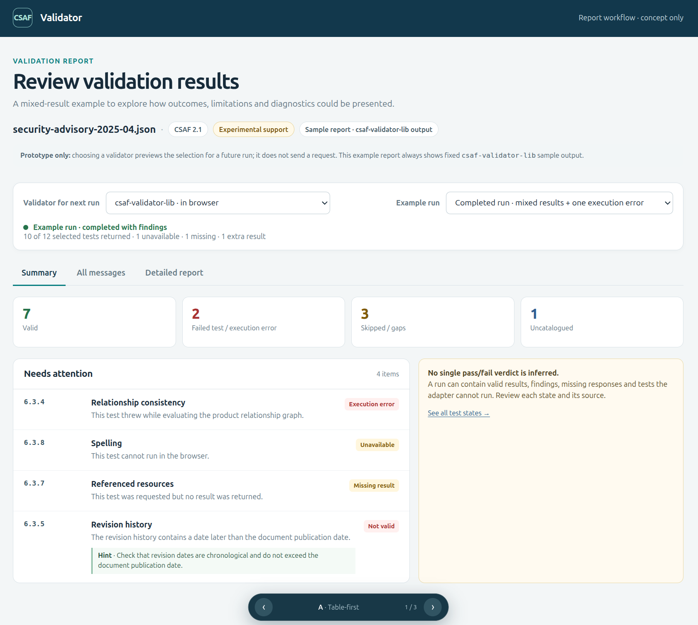

# csaf-validator-tool

## Introduction & Goals

The csaf-validator-tool is a deployable, stateless CSAF advisory validation application that runs entirely in the user's browser.
It is hosted as a static site on GitHub Pages and can also be run locally with Docker Compose together with an externally maintained JavaScript validator service.
A user supplies a CSAF document, picks one validator and a set of checks, runs them, and reviews a table-first report that keeps real validator outcomes strictly apart from missing, unavailable, skipped, cancelled, and failed states.

The app offers four validator choices:

| Validator                | Where it runs                                                                 |
| ------------------------ | ----------------------------------------------------------------------------- |
| `csaf-validator-lib`     | In the browser, in a Web Worker.                                              |
| `csaf-validator-service` | Externally operated JavaScript HTTP service.                                  |
| `csaf-rs-wasm`           | In the browser, only in a Web Worker; exact package `@csaf-rs/csaf-rs@0.7.3`. |
| `csaf-service`           | Externally operated Rust HTTP service. Optional and operator-managed.         |

The csaf-rs CLI cannot be called from a browser and is not an adapter.

**Out of scope.** Do not add a backend, a third-party URL proxy, browser spell-checking, validator comparison, report export, persistent preferences, telemetry, a "run preset" mode, or invocation of local executables. The tool integrates validator components; it does not provision, build, patch, or maintain them.

## Constraints

### Technical Constraints

| Constraint                                           | Explanation                                                                                                                                                                                        |
| ---------------------------------------------------- | -------------------------------------------------------------------------------------------------------------------------------------------------------------------------------------------------- |
| Static, backend-free application                     | Everything runs in the browser. Remote validators are reached directly by the browser; the tool adds no proxy and no server component.                                                             |
| React + TypeScript, Vite, npm                        | English UI with i18next. Node is pinned for contributors and CI, `npm ci` is used with a committed lockfile, and browser dependencies use exact versions.                                          |
| Vitest and Playwright                                | Vitest for unit tests, Playwright for browser automation against latest-stable desktop Google Chrome and Firefox.                                                                                  |
| csaf-rs WASM runs only in a Web Worker               | The 15.6 MB module fails main-thread synchronous instantiation in Chrome (limit 8 MB).                                                                                                             |
| GitHub Pages cannot set custom HTTP response headers | Security must not depend on headers; untrusted data is rendered safely regardless. Assets, module workers, and WASM resolve relative to the deployed app path, including repository project paths. |
| Remote validators need CORS                          | A remote service is usable only if the user's browser can reach it and it allows the app origin. The tool cannot fix or diagnose this.                                                             |
| No browser persistence                               | Documents, results, diagnostics, and settings stay in page memory only.                                                                                                                            |

### Organizational Constraints

| Constraint                                     | Explanation                                                                                                                                                                       |
| ---------------------------------------------- | --------------------------------------------------------------------------------------------------------------------------------------------------------------------------------- |
| Validator components are externally maintained | `csaf-validator-lib`, `@csaf-rs/csaf-rs`, the JavaScript validator service image, and the Rust service are owned elsewhere. Their versions are pinned and updated through review. |
| Specification snapshots are fixed              | CSAF 2.0 OASIS Standard and CSAF 2.1 CSD04. Changing a snapshot is a deliberate, reviewed data update.                                                                            |
| Safari is a manual gate                        | Safari is a supported target but has no CI automation. A recorded manual smoke test is required before each release.                                                              |

## Context and Scope

### Business context

| Communication partner     | Interaction                                                                                                                                       |
| ------------------------- | ------------------------------------------------------------------------------------------------------------------------------------------------- |
| User                      | Supplies a document (text, file, or URL), chooses version, validator, and checks, starts and cancels runs, reads the report.                      |
| Document host (URL input) | Receives the browser's direct request when the user clicks Fetch.                                                                                 |
| Remote validator operator | Receives the complete document and request parameters when the user runs a remote validator. The operator controls its own retention and logging. |
| Repository maintainers    | Maintain the catalogue, adapter mappings, hints, pinned dependencies, and the Compose image digest through reviewed changes.                      |

### Technical context

| Communication partner                 | Channel / protocol             | Interface                                                                                                                                             |
| ------------------------------------- | ------------------------------ | ----------------------------------------------------------------------------------------------------------------------------------------------------- |
| Static host (GitHub Pages or gateway) | HTTPS or HTTP, static files    | App assets, `.well-known/appspecific/runtime-config.json` (optional), the YAML hint file. Normal static loads only.                                   |
| Document host                         | HTTP(S) `GET` from the browser | User-entered absolute `http:`/`https:` URL, fetched directly after an explicit Fetch action. Never proxied.                                           |
| `csaf-validator-lib`                  | In-process, Web Worker         | Reviewed mapping from catalogue entries to functions of the exact locked library version.                                                             |
| `@csaf-rs/csaf-rs@0.7.3`              | In-process, module Web Worker  | Package API verified against the exact version before capabilities are marked supported.                                                              |
| `csaf-validator-service`              | HTTP(S), REST, JSON            | `POST /api/v1/validate` with exact selected test IDs. The service also exposes `GET /api/v1/tests` and `GET /health`; neither establishes capability. |
| `csaf-service` (Rust)                 | HTTP(S), REST                  | Operator-managed endpoint and CORS. Route, request format, and ID mapping verified against the target version.                                        |

## Solution Strategy

### Key decisions

- **Browser-only and stateless.** No backend, no proxy, no persistence, no telemetry (ADR 1, ADR 8).
- **Explicit catalogue.** Checked-in, schema-validated JSON per fixed specification snapshot is the source of truth for numbered test identities. Validator libraries and exports never define it (ADR 2, ADR 11).
- **Separate adapter records.** Per-test capability and identifier mapping data lives apart from the catalogue. Only verified support is generally runnable (ADR 3).
- **Selections, not presets.** `external-request-free` only initializes checked individual tests. A run always means the exact current selection (ADR 2).
- **Truthful results.** Execution state and validation outcome are separate. Absent data is never turned into pass or fail (ADR 6).
- **Per-test worker execution.** Browser validators run each selected test individually, stream results, and are terminated on cancel (ADR 5). The exception is csaf-rs, which runs one full-set call per run (ADR 4).
- **Strict configuration.** Optional runtime JSON is validated all-or-nothing (ADR 7).
- **Two deployment modes from one build.** GitHub Pages on published Releases; local Compose with a loopback-only gateway (ADR 9, ADR 10).

### Quality goals

| Quality goal                    | Solution approach                                                                                                           |
| ------------------------------- | --------------------------------------------------------------------------------------------------------------------------- |
| Truthful reporting              | Distinct result and non-result states; validity counts include only actual returned outcomes; no invented status.           |
| Privacy                         | No telemetry or storage; direct fetches; standing inline disclosure before remote submission.                               |
| Safe handling of untrusted data | Escaped text only; links only for valid absolute HTTP(S) URLs; adapter response validation.                                 |
| Reproducibility                 | Pinned Node, `npm ci`, exact dependency versions, digest-pinned service image, deterministic CI fixtures and mock services. |
| Deployability                   | Relative assets and worker/WASM URLs work under a Pages project path and at the Compose root.                               |

## Building Block View

| Building block         | Responsibility                                                                                                                                                                    |
| ---------------------- | --------------------------------------------------------------------------------------------------------------------------------------------------------------------------------- |
| Document intake        | Text, file, and URL input; JSON parsing; object-shape check; declared-version detection.                                                                                          |
| Settings and config    | Runtime config loader and validator; built-in defaults, runtime values, and session edits with defined precedence.                                                                |
| Catalogue              | Per-snapshot test data, schema-check entry, group and preset memberships, verified specification links.                                                                           |
| Selection              | Initial `external-request-free` selection, individual edits, separate schema-check selection, network-test classification.                                                        |
| Capability and mapping | Per-adapter records of capability state, identifier mapping, execution mode, and evidence/version. Maintained separately from the catalogue.                                      |
| Adapters               | `csaf-validator-lib` worker, `csaf-rs-wasm` worker, JavaScript service client, Rust service client. Each validates its responses and maps results only through reviewed mappings. |
| Run state              | Queued/running/completed/cancelled/failed state, per-test results, progress, and cancellation.                                                                                    |
| Report                 | Status counts, "Needs attention", Summary / All messages / Detailed report views.                                                                                                 |
| Hints                  | Loader and matcher for supplemental hints from a separate YAML file.                                                                                                              |
| Static deployment      | Vite production build, Pages workflow, Compose files, gateway configuration, Compose runtime config.                                                                              |

## Runtime View

### Main interaction flow

1. The user supplies a document as pasted JSON text, a local file, or an HTTP(S) URL fetched directly by the browser.
2. The app validates JSON shape, detects the declared `document.csaf_version`, and lets the user use that version or explicitly choose CSAF 2.0 or 2.1. The selected version is always visible; no other version is silently substituted.
3. The user chooses one validator. The `external-request-free` selection (specification-defined for CSAF 2.1 CSD04, tool-defined for CSAF 2.0) initializes the checked numbered tests, and the user can then adjust individual tests and the separate schema-check checkbox. Adapter and version limitations, and tests that cannot run, are shown before dispatch.
4. If the selection includes network-enabled tests, the app shows which tests may access external resources and requires explicit confirmation before running them.
5. Before a remote submission, the selected service and its configured destination stay visible beside the run controls with an inline disclosure that the full document and request parameters go to that service. There is no per-run confirmation modal.
6. Browser validation runs in a cancellable worker that delivers progress and results incrementally. Service requests go to the configured URL. Cancelling preserves partial state, except for csaf-rs, whose single call returns all results together and keeps none on cancel (ADR 4).
7. The report is table-first, with status totals and a "Needs attention" section. The user switches in place between Summary, All messages (default), and Detailed report. There are no client-side routes.

### Cancellation

- **Browser validators:** the Web Worker is terminated immediately. Results already received are kept and the run is marked cancelled. Selected tests that did not complete are marked "not run — cancelled", never "skipped". A test in progress at termination may have no result. For `csaf-rs-wasm`, which returns all results together, cancelling discards the whole run and the UI says so.
- **Remote services:** the client request is aborted where supported. Results already available are kept and any late response is ignored. The UI states that aborting the browser request does not guarantee the server stopped processing.

## Deployment View

### GitHub Pages

- The static app is deployed at the repository's Pages URL, including project paths such as `https://<org>.github.io/<repo>/`.
- Deployment happens only when a GitHub Release is published and requires the full check suite to pass for the release commit. PR and `main` builds are never deployed.
- Browser-local validators work without any remote service. A remote service works only if the user's browser can reach it and it allows the app origin via CORS.
- The JavaScript service currently supports CSAF 2.0, not 2.1. The app does not claim support the configured endpoint has not demonstrated.

### Local Compose

| Service        | Role                                                                                                                        |
| -------------- | --------------------------------------------------------------------------------------------------------------------------- |
| `app`          | Serves the Vite production build as static files.                                                                           |
| `validator-js` | Runs the externally maintained JavaScript validator image. It listens on `8082` inside the private network only.            |
| `gateway`      | The only browser-facing reverse proxy. It serves the app, proxies `/api/v1/*` and `/health`, and serves its own `/healthz`. |

- The browser-visible origin is `http://127.0.0.1:8080/`. Only the gateway is published, as `127.0.0.1:8080:80`; the app and validator ports are not published. LAN exposure requires a deliberate local edit after an exposure review; it is not a default toggle.
- The gateway proxies `/api/v1/*` to `validator-js:8082` without changing the path and `/health` to the validator's health endpoint. User-entered document URLs are never proxied.
- `CSAF_VALIDATOR_IMAGE` comes from an ignored local `.env`. It must be an immutable digest reference, and Compose fails when it is missing, with no fallback to `latest` or a mutable tag. The initial verified reference is `ghcr.io/secvisogram/csaf-validator-service@sha256:e09b8a2b7c7715cce3de2144d73789a06df85a3d116ff07229199060f2e6e5db` (image-index digest resolved from `latest` and pulled on 2026-11-15, `linux/amd64`). Its Docker health check probes `http://127.0.0.1:8082/health`. When the pin is deliberately updated, verify the `8082` listener, `/health`, and `/api/v1/*` contract.
- App and gateway startup do not depend on validator health. If the validator is unhealthy, the UI stays available and reports the service failure.
- A Compose-specific `.well-known/appspecific/runtime-config.json` selects `csaf-validator-service` by default and sets `services.javascript` to `http://127.0.0.1:8080`, so requests are same-origin and need no CORS. It is kept separate from the Pages configuration.
- A Rust `csaf-service` is not part of the stack: it is not built, published, proxied, or health-checked. An operator who runs it separately can set `services.rust` to its browser-reachable URL and configure its CORS allowlist for the exact app origin.
- Operator documentation covers startup (`docker compose up -d`), the URL, status (`docker compose ps`), logs (`docker compose logs -f gateway validator-js`), shutdown, image override, and troubleshooting.

**Evidence for the pinned image (2026-11-15).** A loopback-only container smoke test returned HTTP 200 from `/health`. A CSAF 2.0 request to `/api/v1/validate` returned HTTP 200 with 44 per-test results, including a validator-reported failing test and top-level `isValid: false`. HTTP success means the service completed the request; it does not mean the document passed.

## Crosscutting Concepts

### Specification snapshots and links

- CSAF 2.0 is pinned to the OASIS Standard HTML: <https://docs.oasis-open.org/csaf/csaf/v2.0/os/csaf-v2.0-os.html>.
- CSAF 2.1 is pinned to OASIS CSD04: <https://docs.oasis-open.org/csaf/csaf/v2.1/csd04/csaf-v2.1-csd04.html>. It is identified as experimental CSD04, not a final standard.
- Never use a moving "latest" URL. If the supported 2.1 stage changes, updating the pinned document and mapping is a deliberate catalogue change.
- Each numbered test keeps an explicit, version-specific mapping from its section to a verified fragment in the pinned document. Fragments are not derived from section numbers, because they differ between versions, can be descriptive, and may be shared by several tests.
- If a mapped fragment is absent, the section number is shown without a link and the entry is flagged for maintenance. No replacement is guessed.
- Schema checks get a link only if a related section is established.

### Catalogue

- Checked-in, schema-validated JSON, one file per snapshot. It includes every individually numbered test in the snapshot's test sections, whether or not any validator implements it.
- Stable identity is the snapshot identifier plus the exact section string, such as `csaf-2.0/6.1.1` and `csaf-2.1-csd04/6.1.1`. Tests are never keyed by library export or function name.
- Each entry records the snapshot, section ID, exact specification title, group, defined preset memberships, and a verified specification URL and fragment. Descriptions and anchors are not invented.
- Group names are preserved per snapshot. CSAF 2.0 uses `mandatory`, `optional`, `informative`. CSAF 2.1 CSD04 uses `mandatory`, `recommended`, `informative`.
- Preset memberships are included only where the pinned specification defines them, including membership implied by set composition.
- Schema validation has no 6.x ID. It is represented separately (for example `csaf-2.1-csd04/schema`), with strictness and capability metadata where verified, and is a member of a named selection only where the corresponding specification defines it. It may be selected independently if the adapter supports it.
- Trimmed OASIS validator manifests are checked in as completeness baselines for IDs and groups: 74 tests for CSAF 2.0 and 218 for CSAF 2.1 CSD04. CI normalizes manifest IDs to snapshot/section identity and compares coverage and group assignments. CI also fails on duplicate IDs, invalid groups, incorrect preset memberships, and unresolved or wrong-version fragments, and validates the catalogue schema. The manifests supply neither titles nor fragments, which are verified against the fixed specification prose and HTML.
- Catalogue corrections, membership changes, and anchor changes are reviewed data updates. Nothing is synchronized from `csaf-validator-lib` releases.

An illustrative entry (actual data contains all tests and verified fields; the membership and fragment below are not verified):

```json
{
  "snapshot": "csaf-2.1-csd04",
  "tests": [
    {
      "id": "csaf-2.1-csd04/6.1.1",
      "section": "6.1.1",
      "title": "Missing Definition of Product ID",
      "group": "mandatory",
      "memberships": [
        "mandatory",
        "basic",
        "extended",
        "full",
        "external-request-free"
      ],
      "specificationUrl": "https://docs.oasis-open.org/csaf/csaf/v2.1/csd04/csaf-v2.1-csd04.html#missing-definition-of-product-id"
    }
  ],
  "schemaCheck": {
    "id": "csaf-2.1-csd04/schema",
    "memberships": [
      "schema",
      "basic",
      "extended",
      "full",
      "external-request-free"
    ]
  }
}
```

### Initial selection and user editing

- The default CSAF version is `document`: read the declared version and select the matching catalogue. Explicit 2.0 and 2.1 are also available. A missing or unsupported document version is an input/selection problem, not a test failure.
- The initially checked numbered tests are the `external-request-free` set. For CSAF 2.1 CSD04 it is specification-defined as `full` excluding the `non-external-request-free` set (6.2.55, 6.3.6, 6.3.7, 6.3.24). The CSAF 2.0 standard defines no such set, so the tool-defined equivalent is `full` excluding 6.3.6 and 6.3.7 and is labelled as tool-defined. The separate schema-check selection is initialized from the same set's membership definition.
- There is no "run preset" mode or preset execution request, even if the selection happens to match a preset. Users adjust tests individually, and each run executes exactly the selected supported tests and schema check.
- Unselected rows stay visible in the Detailed report. A selected test the adapter cannot run stays selected as unavailable with a known reason and is not silently removed from the requested scope.
- Browser adapters never invoke network-enabled tests before confirmation. Network-enabled classification is explicit and version-specific.

### Adapter capability and mapping

Adapter mapping and capability data is maintained separately from the catalogue. Each record names the target snapshot and section, the adapter identifier or function, the execution mode, and the evidence and version. Per test and schema check, the capability state is one of:

- `verified-supported`
- `known-unsupported` (with a reason)
- `not-yet-verified`

Only verified support is generally presented as runnable. The one explicit exception is a user-selected CSAF 2.1 request to the JavaScript service: it is sent despite `not-yet-verified`, the unverified status is disclosed, and only the actual response or error is shown. The user's selection authorizes an attempt, not a claim of support. Support is never inferred from a library export, a service-discovery endpoint, a result identifier, or a package README. Library exports can be targets of an explicit, reviewed mapping but are never the catalogue source.

Returned results map to catalogue tests only through an explicit, reviewed, snapshot-specific mapping. The adapter's original identifier, subtest suffixes, and schema identity are preserved. A result without an exact verified mapping stays visible as uncatalogued with its original ID and unmodified details. A response that lacks a requested result is not automatically skipped or passed.

| Adapter                  | Execution and request behavior                                                                                                                              | Known limitations and required verification                                                                                                                                                                                                                                                                                                                                                                                                                                                                                                                                                              |
| ------------------------ | ----------------------------------------------------------------------------------------------------------------------------------------------------------- | -------------------------------------------------------------------------------------------------------------------------------------------------------------------------------------------------------------------------------------------------------------------------------------------------------------------------------------------------------------------------------------------------------------------------------------------------------------------------------------------------------------------------------------------------------------------------------------------------------- |
| `csaf-validator-lib`     | Map supported catalogue entries to exact functions of the locked version. Run selected checks individually in a Web Worker, streaming progress and results. | Browser-incompatible tests, including Hunspell-backed 6.3.8 and unconfirmed external-network tests, stay visible as unavailable with reasons. One thrown test never erases completed independent results. Exact npm pin (3.0.3 at handoff).                                                                                                                                                                                                                                                                                                                                                              |
| `csaf-rs-wasm`           | Exact `@csaf-rs/csaf-rs@0.7.3`, loaded and called from a module Web Worker only. Assets are relative to the app path.                                       | Unmodified 0.7.2 initialized and returned 44 successful results for a CSAF 2.0 fixture in Chromium 156.0.8078.73 and Firefox 157.0.1 at `/project/demo/`. Version 0.7.3 (same TypeScript bindings, a larger WASM) returned the same results through the app in Chromium 156.0.8078.73 and Firefox 159.0. Safari is unverified. The package takes only a preset and cannot run individual tests, so every run is the `full` preset for the selected version, filtered to the selection. Package IDs are the catalogue sections and `schema`. Statuses are `Success`, `Failure`, `Skipped` and `NotFound`. |
| `csaf-validator-service` | `POST /api/v1/validate` with the exact selected test IDs, never a native preset.                                                                            | Verified service is CSAF 2.0 only. A selected CSAF 2.1 request may still be sent. No `external-request-free` preset and no skipped state in the response. Whole-request errors are service failures, not inferred test failures. Per-version IDs and response mapping must be verified.                                                                                                                                                                                                                                                                                                                  |
| `csaf-service`           | Configurable, separately operated Rust REST endpoint; exact selected test IDs, never a preset.                                                              | URL and CORS are operator-managed. The observed legacy response flattens `Skipped` to valid and cannot represent `NotFound`. Only actual communicated information is reported. Exact API, version, and ID mappings must be verified before support is marked verified.                                                                                                                                                                                                                                                                                                                                   |

### Result model

Execution state and validation outcome are kept distinct. Each catalogue row can show:

- Not selected.
- Selected but unavailable to the adapter, with a reason.
- Queued or running.
- Validator-reported success or failure, with all returned errors, warnings, and information.
- Validator-reported skipped, only when the adapter actually supplies it.
- Requested but missing from a completed response.
- Execution error for one test when an individual invocation throws.
- Run or service failure when the request, response, worker, or adapter fails.
- Not run because the user cancelled; results completed before cancellation are retained.
- Uncatalogued returned result with its original ID and unmodified details.

None of the non-result states means pass or fail. `NotFound`, a missing result, status loss, and a network error are never turned into a successful outcome. Validity counts include only actual returned validation outcomes; unavailable, missing, skipped, not-selected, failed-run, and cancelled states are displayed separately.

### Report

The report follows the table-first direction (see [ADR 6](#adr-6-table-first-report-with-truthful-result-states)):

1. Status counts and overall run state.
2. A "Needs attention" section with returned findings, unavailable checks, missing results, execution and service failures, and cancellation gaps, without inventing findings.
3. In-page tabs: **Summary**, **All messages** (default), and **Detailed report**. No client-side routes.
4. A detailed table listing every selected and unselected catalogue test with its current status, a section link where verified, messages, and supplemental hints.

Partial results are retained. For browser execution, catalogue tests run individually and each result is streamed as it completes.

### Document input and safe rendering

- **URL input.** Parse with the platform URL parser and accept only absolute `http:` and `https:` URLs with a hostname and no embedded credentials. Reject other schemes before any request. Fetch directly from the browser only after the user's explicit Fetch action, with normal browser redirects and no credentials added by the app. Never proxy or rewrite the URL. Check the final response's HTTP success status before reading the body, then parse it as JSON.
- **Fetch failures.** Explain generically that browser fetch, CORS, network, and permission restrictions can look alike. Show the HTTP status if one is available, and offer text and file input. Do not assert a specific cause and do not treat a redirect as unsafe or broken. There is no separate privacy prompt before fetching.
- **JSON.** Text, URL bodies, and uploaded files must be valid JSON with a non-null object at the top level. Arrays, scalars, and malformed JSON get actionable errors. CSAF validity is decided by the selected validator, not the input parser. Files are read as text and use the same parser.
- **Size.** No application-level size cap and no silent truncation. Browser, file API, memory, and validator limits are shown as user-visible errors.
- **Untrusted data.** Treat the document, service responses, validator messages, URLs, and YAML hints as untrusted. Render escaped text through framework text interpolation; never use `innerHTML`, never evaluate content, and never interpret Markdown or HTML. Create links only from valid absolute `http:` or `https:` URLs; show malformed or unsafe-scheme values as plain text. External links that open a new window use `rel="noopener noreferrer"`.
- **Failures are not results.** Validate response shape at each adapter boundary. HTTP errors, malformed bodies, timeouts, network and CORS errors, thrown validator calls, and worker crashes are run, adapter, or service failures. Show safe technical details and status codes where available, and never invent per-test results. Do not diagnose causes the browser cannot observe.

### Privacy and telemetry

- No analytics, telemetry, crash reporting, or automatic diagnostics. Diagnostics remain in the local UI and browser console.
- Documents, results, diagnostics, and settings are not persisted in local or session storage, IndexedDB, cookies, or any other browser storage. They are held in page memory only.
- Browser validators process the document locally; WASM execution stays in its Web Worker.
- A remote validator necessarily receives the whole document and its request parameters. The selected service and its configured destination are visible beside the run controls before the run, with an inline disclosure that the whole document is sent and that the service operator controls retention and logging. The app does not claim to guarantee an external service's data handling. There is no per-run confirmation modal.
- Ordinary static asset, runtime config, and hint loads are allowed. Documents, results, entered URLs, endpoints, and diagnostics are never sent to an analytics or reporting endpoint.
- The confirmation before running network-enabled tests is separate from the standing remote-service disclosure and is retained.

### Runtime configuration

Optional JSON is loaded from `.well-known/appspecific/runtime-config.json`, resolved relative to the app path so Pages project paths work.

```json
{
  "version": 1,
  "services": {
    "javascript": "http://127.0.0.1:8080",
    "rust": "http://127.0.0.1:8080"
  },
  "defaults": {
    "validator": "csaf-validator-lib",
    "csafVersion": "document",
    "reportView": "all-messages"
  }
}
```

- All fields other than `version` are optional. Allowed validators: `csaf-validator-lib`, `csaf-validator-service`, `csaf-service`, `csaf-rs-wasm`. Versions: `document`, `2.0`, `2.1`. Report views: `summary`, `all-messages`, `detailed`.
- The file is strict and all-or-nothing: require `version: 1`; reject unknown fields, incorrect types, unsupported enum values, and malformed service URLs. An invalid file is ignored as a whole; valid fields are never partially applied.
- Service URLs must be absolute HTTP(S) without credentials, query, or fragment. Paths are preserved and the trailing slash is normalized.
- A missing file, including HTTP 404, silently uses built-in defaults. Other fetch errors and invalid content are reported before falling back.
- Precedence: built-in defaults, then valid runtime configuration, then current-session user edits. Edits are not persisted.
- Runtime configuration cannot set a preset or individual test selections. The initial selection always follows the version-specific `external-request-free` definition.
- `services.javascript` and `services.rust` configure the matching remote adapters.

### Hints

- Supplemental hints are stored in a separate, editable YAML file. They are explanatory content, not validation results, and never change results, run states, or validity counts.
- A hint is keyed by CSAF version and section. A general test hint has only these keys. A validator-message hint additionally names the validator and exactly one message key: the validator's stable `messageCode` where it supplies one, otherwise its original `messageText`.
- Matching uses exact, case-sensitive string equality against the original, unmodified validator value. There is no substring, regular-expression, fuzzy, or translated-text matching, and no normalization.
- Precedence: exact stable-code hint, exact message-text hint, general test hint.
- Hint identities (version, section, validator, and message key as applicable) must be unique. YAML order never decides which hint is shown.
- The file is validated against a schema at load time. A malformed file or duplicate identity rejects the whole file with a clear warning, and validation and reporting continue without hints.

```yaml
hints:
  - csafVersion: '2.1'
    section: '6.3.8'
    text: 'General guidance for this test.'

  - csafVersion: '2.1'
    section: '6.3.8'
    validator: csaf-validator-service
    messageCode: SPELLING_ERROR
    text: 'Validator-specific guidance for this message.'

  - csafVersion: '2.1'
    section: '6.3.8'
    validator: csaf-service
    messageText: 'Spelling mistakes found in document title.'
    text: 'Guidance for this exact validator message.'
```

### Dependency policy

- Browser packages use exact versions recorded in the lockfile. The JavaScript service image is pinned by immutable digest, with a documented operator override.
- Dependency and image updates are reviewed changes, never automatic merges. Automated checks inform the review: project checks, real-browser WASM instantiation and a representative validation before enabling or updating WASM, and API and health checks for the service image.
- A failing update keeps the last verified pin. The limitation is documented and the tool waits for a compatible upstream release rather than patching or maintaining the validator component.
- The verified Compose image supports CSAF 2.0. An explicit CSAF 2.1 selection is still allowed (see Adapter capability and mapping); a future upstream update is not a prerequisite for attempting it, and the app does not imply current 2.1 support.

### Report prototype

The selected direction is the table-first layout: status counts, a "Needs attention" panel, and Summary / All messages / Detailed report tabs. The screenshot comes from a static HTML prototype with fixed sample output from `csaf-validator-lib`; it executes no validator.



The prototype illustrates hierarchy and layout only. It is not normative for count grouping: its cards combine "Failed test / execution error" and "Skipped / gaps", while this specification requires validation outcomes to be counted separately from execution errors and non-result states (see Result model).

## Architecture decisions

| #   | Title                                                     | Status   |
| --- | --------------------------------------------------------- | -------- |
| 1   | Browser-only static app without backend or proxy          | Accepted |
| 2   | Explicit checked-in catalogue; presets only initialize    | Accepted |
| 3   | Separate adapter capability records and exact test IDs    | Accepted |
| 4   | csaf-rs WASM at exact 0.7.3, Web Worker only              | Accepted |
| 5   | Per-test worker execution with streaming and termination  | Accepted |
| 6   | Table-first report with truthful result states            | Accepted |
| 7   | Strict all-or-nothing runtime configuration               | Accepted |
| 8   | No telemetry, no persistence, inline remote disclosure    | Accepted |
| 9   | Vite and npm toolchain; Pages deploy on published Release | Accepted |
| 10  | Loopback-only Compose gateway with digest-pinned image    | Accepted |
| 11  | Fixed specification snapshots with verified links         | Accepted |
| 12  | Separate YAML hints with exact match keys                 | Accepted |
| 13  | Exact dependency pins and reviewed updates                | Accepted |
| 14  | Safe input handling and escaped rendering                 | Accepted |

### ADR 1: Browser-only static app without backend or proxy

**Context**: The tool should be hosted simply (GitHub Pages) and must not become an operated service. Validator components stay externally maintained.

**Decision**: Ship a static application that runs entirely in the browser. Do not add a backend or a URL-fetch proxy. Remote validators are separately operated and reached directly by the browser.

**Consequences**:

- Positive: nothing for the project to operate or secure server-side, and documents stay local unless the user chooses a remote validator.
- Negative: remote validators depend on the user's network and the operator's CORS policy, and the tool cannot diagnose such failures.
- Negative: fetching a document from another origin depends on that host's CORS policy; the tool offers text and file input as alternatives.

### ADR 2: Explicit checked-in catalogue; presets only initialize

**Context**: Validator libraries differ in which tests they implement and how they name them. Using their exports as the catalogue would make the product's scope depend on whichever implementation is selected, and would hide specified tests that nobody implements.

**Decision**: Maintain a checked-in, schema-validated catalogue per fixed specification snapshot as the source of truth for test identity, title, group, memberships, and links, independent of every adapter. Validate it in CI against checked-in OASIS manifest baselines for completeness. Presets are not execution modes: `external-request-free` only initializes the checked individual tests, and every run executes the exact selection.

**Consequences**:

- Positive: the report can show every specified test, including those no adapter supports.
- Positive: adapters can be swapped or updated without changing the product's definition of the test set.
- Negative: maintainers carry the cost of reviewed catalogue updates when a snapshot changes.
- Negative: manifests give IDs and groups only, so titles and fragments must be verified by hand against the specification.

### ADR 3: Separate adapter capability records and exact test IDs

**Context**: Adapters differ in test coverage, identifiers, and result semantics, and some of this is only verifiable against exact versions.

**Decision**: Keep per-test capability and identifier-mapping records separate from the catalogue, with states `verified-supported`, `known-unsupported`, and `not-yet-verified`. Services always receive the exact selected IDs, never a native preset. Results map to the catalogue only through reviewed, snapshot-specific mappings; others stay uncatalogued. The single exception to "only verified support is runnable" is an explicit CSAF 2.1 request to the JavaScript service.

**Consequences**:

- Positive: no support claim without evidence, and unmappable results are visible rather than guessed.
- Positive: the explicit CSAF 2.1 attempt avoids an app-side gate that could block a service that does support it, while still disclosing that support is unverified.
- Negative: each adapter needs verification work against its exact version before its capabilities appear as supported.

### ADR 4: csaf-rs WASM at exact 0.7.3, Web Worker only

**Context**: `@csaf-rs/csaf-rs@0.7.1` could not be instantiated unchanged in Chromium 156.0.8078.47 or Firefox 157.0.1 because the WASM requested imports absent from the shipped runtime. A diagnostic-only workaround proved nothing about safe shipping, so the adapter was blocked. Version 0.7.2 (published 2026-11-13) ships explicit import shims. A throwaway Vite 6.4.1 production build with `base: './'` and an ES module worker loaded the unmodified package from `/project/demo/` and validated a CSAF 2.0 advisory using the `basic` preset, returning `success: true` and 44 successful results in Chromium 156.0.8078.73 and Firefox 157.0.1. Direct main-thread initialization failed in Chromium with `WebAssembly.Instance is disallowed on the main thread, if the buffer size is larger than 8MB`. Safari was not tested. Version 0.7.3 (published 2026-11-17) has TypeScript bindings identical to 0.7.2 and a 15.6 MB WASM. It lists the same tests, returned the same `NotFound` sets over all OASIS validator test documents, and loaded and validated through the built app at the root and a subpath in Chromium 156.0.8078.73 and Firefox 159.0.

**Decision**: Offer `csaf-rs-wasm` at the exact `@csaf-rs/csaf-rs@0.7.3` pin, loaded and called only from a module Web Worker, without patching the package. The package accepts only presets, so each run calls the version-specific function with the `full` preset and filters the results to the selection. The results are held until the call returns, so a cancel or failure leaves no partial results. A `NotFound` for a test that the capability data lists as supported becomes an execution error for that test. The tests that return `NotFound` in every run over the OASIS validator test documents (3 for CSAF 2.0, 29 for CSAF 2.1, including all network-enabled tests) are `known-unsupported` in the hand-edited `src/adapters/csafrs/capabilities.json`. Safari was not tested, and the user decided not to block availability on it. A manual Safari WASM smoke test is required before every release.

**Consequences**:

- Positive: a second in-browser validator that does not depend on a remote service.
- Negative: a 15.6 MB module to load, and the adapter works only in a worker.
- Negative: the package runs only presets. Every run executes the full set of the selected version, so the adapter filters results, cannot report per-test progress, and cannot keep partial results on cancel. This is an exception to ADR 5.
- Negative: Safari remains unverified until the first manual release check.
- Negative: any version update must repeat real-browser initialization and validation checks (ADR 13).

### ADR 5: Per-test worker execution with streaming and termination

**Context**: Users need progress, and need to cancel without losing finished work. The csaf-rs adapter is an exception (see ADR 4).

**Decision**: Browser adapters run selected tests individually in a Web Worker, report progress against the runnable selected tests, and deliver each result as soon as it completes. Cancelling terminates the worker immediately, keeps received results, and marks unfinished selected tests "not run — cancelled". A thrown test is recorded as an execution error and independent tests continue. Remote cancellation aborts the request where supported, ignores late responses, and states that server-side work may continue.

**Consequences**:

- Positive: completed results survive cancellation and individual failures.
- Negative: a test in progress at termination has no result.

### ADR 6: Table-first report with truthful result states

**Context**: A prototype compared three report layouts using mixed validator output, including an error and a cancelled run. Reports must make returned, missing, skipped, unavailable, unselected, and uncatalogued states distinguishable.

**Decision**: Choose the table-first layout: status counts, a "Needs attention" summary, in-page Summary / All messages (default) / Detailed report tabs, and a detailed table that makes every catalogue state explicit. Validator selection sits beside the run controls. No client-side routes. No single pass/fail verdict is inferred.

**Consequences**:

- Positive: users see counts and problems first, with the full detail one tab away.
- Negative: the prototype's grouped count cards do not match the strict count rules; the implementation must follow the Result model, not the prototype's grouping.

### ADR 7: Strict all-or-nothing runtime configuration

**Context**: Deployments need service endpoints and startup defaults without rebuilding the static app, and a half-applied configuration would make behavior hard to predict.

**Decision**: Use a versioned, strict, optional JSON file at an app-relative path, validated as a whole. An invalid file is reported and replaced by built-in defaults. It configures only service URLs and validator, version, and report-view defaults, never presets or test selections. User edits override runtime values for the session only.

**Consequences**:

- Positive: predictable behavior and the same file mechanism for Pages and Compose.
- Negative: one invalid field disables the whole file; this is deliberate.

### ADR 8: No telemetry, no persistence, inline remote disclosure

**Context**: Documents can be confidential, and a remote validator necessarily receives the whole document. A per-run confirmation modal was considered and declined by the user.

**Decision**: Send no analytics or diagnostics and persist nothing. Keep a persistent inline disclosure of the selected service and destination beside the run controls instead of a modal. Keep the separate confirmation for network-enabled tests. Fetch user-entered URLs directly without an added privacy prompt.

**Consequences**:

- Positive: no data leaves the browser except by the user's explicit action, and the flow has no repeated modal friction.
- Negative: crash and usage data are unavailable to maintainers; diagnostics stay in the local UI and console.
- Negative: the app cannot guarantee how an external service handles a request; it can only state that the operator controls it.

### ADR 9: Vite and npm toolchain; Pages deploy on published Release

**Context**: The build must handle project base paths, Web Worker and WASM assets, and both Pages and Compose deployment.

**Decision**: Use Vite with React and TypeScript, npm with a committed lockfile, a pinned Node version, Vitest, and Playwright on Chromium and Firefox. CI runs on pull requests and pushes to `main` and does not deploy. GitHub Pages deploys only when a GitHub Release is published. The app is a single-page workflow without path-based routing, so report views stay in-page. Configure relative generated asset URLs and Vite-compatible worker references, and verify the built output under a Pages project subpath and the Compose root.

**Consequences**:

- Positive: one build serves both deployment modes without root-relative URLs.
- Negative: Safari has no automation, so a manual smoke test gates every release.

### ADR 10: Loopback-only Compose gateway with digest-pinned image

**Context**: A local deployment should work without CORS setup and without exposing the validator, and the tool must not take over maintenance of the validator image.

**Decision**: Three services on a private network (`app`, `validator-js`, `gateway`), with only the gateway published on `127.0.0.1:8080:80`. The gateway serves the app and proxies `/api/v1/*` and `/health`. The validator image comes from `CSAF_VALIDATOR_IMAGE`, must be an immutable digest, and is never built or patched here. App and gateway start even when the validator is unhealthy. Rust service support stays operator-owned and outside the stack.

**Consequences**:

- Positive: same-origin requests need no CORS configuration, and nothing but the gateway is reachable.
- Positive: UI availability does not depend on the external service's health.
- Negative: updating the validator means deliberately changing the digest after review and smoke testing.
- Negative: the Compose smoke test is manual because it needs Docker and the external image.

### ADR 11: Fixed specification snapshots with verified links

**Context**: Fragment identifiers differ between specification versions, can be descriptive, and may be shared by several tests, and a moving "latest" URL would silently change what a link means.

**Decision**: Pin CSAF 2.0 to the OASIS Standard HTML and CSAF 2.1 to CSD04. Maintain explicit, verified section-to-fragment mappings, never generated from section numbers. A missing anchor means no link and a maintenance flag.

**Consequences**:

- Positive: links always point to the intended text.
- Negative: changing the supported 2.1 stage is a deliberate catalogue update.

### ADR 12: Separate YAML hints with exact match keys

**Context**: Contributors should be able to add guidance for specific tests and validator messages without coupling it to fragile rendered text or to application code.

**Decision**: Store hints in a separate editable YAML file with exact keys (version, section, optionally validator and one message key), a fixed precedence, unique identities, and whole-file rejection with a warning on any invalid content. Translated UI strings are never keys.

**Consequences**:

- Positive: deterministic matching that does not depend on YAML order.
- Negative: a message whose wording changes silently loses its message-specific hint; the general test hint still applies.

### ADR 13: Exact dependency pins and reviewed updates

**Context**: Validator behavior is version-specific, and the tool's claims about capability rely on evidence for exact versions.

**Decision**: Pin browser packages exactly in the lockfile and the service image by digest. Updates are reviewed, with compatibility smoke tests. A failing update keeps the previous verified pin, and validator components are not patched or maintained here.

**Consequences**:

- Positive: reproducible builds and capability claims tied to evidence.
- Negative: validator updates are manual, and the tool may lag behind upstream.

### ADR 14: Safe input handling and escaped rendering

**Context**: Documents, validator responses, URLs, and hints all come from outside the app, and GitHub Pages cannot send protective headers.

**Decision**: Treat all of it as untrusted text. Render escaped text only, create links only for valid absolute HTTP(S) URLs, and validate response shapes at adapter boundaries. Failures of requests, responses, workers, and thrown validator calls are run or service failures, never test results.

**Consequences**:

- Positive: no markup or script injection path from external content, independent of response headers.
- Negative: hint and message content cannot use rich formatting.

## Quality Requirements

### Acceptance criteria

1. The static app builds reproducibly from a clean checkout with a pinned Node version, `npm ci`, locked dependencies, and no product backend.
2. The GitHub Pages production output loads all scripts, styles, config, hints, worker code, and WASM from a repository project path using relative assets.
3. Users can supply text, a file, or a credential-free HTTP(S) document URL. Input validation and failures follow the input contract, with no app-level size cap and no URL proxy.
4. The complete fixed-snapshot catalogue validates against the checked-in manifest baselines (74 IDs and groups for 2.0, 218 for 2.1 CSD04). Default checked tests follow the correct `external-request-free` definition, users can edit tests and the separate schema check, and runs execute exact selections with no preset-run mode.
5. All four adapters have separate explicit mapping and capability records. WASM 0.7.3 is exact-pinned and worker-only. Adapter behavior, request shape, identifier mapping, status semantics, and capability limits are verified against exact dependency and service versions before support is marked verified.
6. Browser tests run in latest-stable Chrome and Firefox. WASM initializes and a representative validation succeeds in both. CI records the browser versions.
7. The Summary, All messages, and Detailed report views faithfully retain statuses, findings, unavailable, missing, and uncatalogued outcomes, failures, and cancelled partial results.
8. Remote submissions disclose the selected endpoint before the run, no extra service confirmation modal is shown, and the app sends no telemetry or automatic diagnostics. No document, result, or session data persists.
9. Untrusted document, response, and hint strings cannot inject markup or script. Links use only safe HTTP(S) targets. Malformed responses and service errors are not test results.
10. Runtime configuration passes strict-schema, fallback, precedence, and app-relative-path tests.
11. Compose serves the app on loopback, routes same-origin service requests, pins the externally maintained image by digest, starts the UI despite validator health failure, and leaves Rust optional and operator-owned.
12. A Safari pre-release smoke test, including WASM worker validation, is recorded before each GitHub Release deployment. Deployment occurs only on a published Release.
13. Compose integration is manually checked against the pinned JavaScript image. The app accurately represents the service's current CSAF 2.0 limitation and does not infer document success from HTTP success.

### Browser and release test matrix

| Area               | Automated on PRs and `main`                                                                                                                                         | Manual before release or local operation                                                         |
| ------------------ | ------------------------------------------------------------------------------------------------------------------------------------------------------------------- | ------------------------------------------------------------------------------------------------ |
| Browser versions   | Latest-stable desktop Chrome and Firefox, with versions recorded. Playwright's bundled Chromium alone does not count as Chrome coverage.                            | Latest-stable desktop Safari, with version, date, and outcome recorded.                          |
| Input              | Text, file, valid and invalid URL fetch, mocked CORS failure guidance, malformed JSON, and non-object payloads.                                                     | Safari text, upload, and URL fetch smoke. Real-source failures are not required.                 |
| Selection          | Declared and explicit CSAF 2.0/2.1, initial `external-request-free` checks, individual edits, schema-check selection, network-test confirmation, capability states. | Verify configured endpoints and services as available.                                           |
| Reports            | Three report views, all result and non-result states, missing and uncatalogued results, and no invented status.                                                     | Safari report navigation and representative states.                                              |
| Execution          | Worker progress, per-test messages, cancel with retained results, 0.7.3 WASM load and fixture validation, errors, and malformed service responses.                  | Safari WASM worker validation; Compose with the real image.                                      |
| Runtime and deploy | Missing and invalid config, precedence, and relative asset, worker, and WASM loading under a project prefix and at the app root.                                    | Published Pages asset smoke; local Compose start, health, request, and failure flow.             |
| Privacy / security | No persistence or telemetry, safe text and link rendering, remote disclosure, and network-test confirmation.                                                        | Review the actual service URL disclosure before a local run; Rust only if separately configured. |

CI uses deterministic document fixtures and controlled or local mock validator services. It does not require a live external service.

### Manual Compose smoke test

Against the pinned image: the loopback app loads; gateway `/healthz` and the proxied `/health` respond; a valid CSAF 2.0 request traverses `/api/v1/validate` and its results are shown as returned; a stopped or unhealthy validator is visibly reported; no other host ports are exposed. Check the Rust service only when an operator has configured it.

## Risks and Technical Debt

Ordered by priority (highest first):

| #   | Risk / Technical Debt                                               | Impact                                                                                          | Suggested mitigation                                                                                                                                                         |
| --- | ------------------------------------------------------------------- | ----------------------------------------------------------------------------------------------- | ---------------------------------------------------------------------------------------------------------------------------------------------------------------------------- |
| 1   | Adapter behavior is unverified until checked against exact versions | Wrong ID mappings or status semantics would produce false results.                              | Verify request schema, ID mapping, network-test behavior, and status mapping per adapter before marking support verified. Unknown mappings stay unavailable or uncatalogued. |
| 2   | Safari is untested for csaf-rs WASM                                 | The adapter may fail in Safari without CI noticing.                                             | Required manual Safari smoke test before every release; recorded in the release checklist.                                                                                   |
| 3   | CORS and local-network permission behavior varies by browser        | Remote services may fail in ways the app cannot observe.                                        | Do not diagnose causes; show safe technical details and offer alternatives. Document operator CORS requirements.                                                             |
| 4   | The JavaScript service supports CSAF 2.0 only                       | CSAF 2.1 requests may fail or return incomplete results.                                        | Allow an explicit 2.1 request, disclose unverified support, show only the actual response or error, and document the limitation.                                             |
| 5   | The Rust service loses status information                           | `Skipped` is flattened to valid and `NotFound` cannot be represented.                           | Disclose the limitation next to the results and never reconstruct states.                                                                                                    |
| 6   | The 15.6 MB WASM module                                             | Slow first load and main-thread limits in Chrome.                                               | Worker-only execution; keep the exact pin and re-verify on any update.                                                                                                       |
| 7   | Catalogue maintenance                                               | Specification updates, anchor changes, or membership corrections require manual, reviewed work. | CI checks against manifest baselines and fixed anchors; treat every change as a reviewed data update.                                                                        |
| 8   | "Latest stable" browsers move                                       | A new browser release can break CI unexpectedly.                                                | Treat it as a normal failure and fix it; do not pin an old browser.                                                                                                          |
| 9   | Observations come from 2026-11-02 to 2026-11-15                     | Upstream behavior may have changed since.                                                       | Re-verify upstream behavior at implementation time against exact selected versions.                                                                                          |

## Glossary

| Term                    | Definition                                                                                                                                         |
| ----------------------- | -------------------------------------------------------------------------------------------------------------------------------------------------- |
| CSAF                    | Common Security Advisory Framework, the OASIS standard format for machine-readable security advisories.                                            |
| CSD04                   | OASIS Committee Specification Draft 04 of CSAF 2.1. Experimental; not a final OASIS Standard.                                                      |
| Catalogue               | The checked-in list of numbered specification tests for one fixed snapshot, independent of any validator.                                          |
| Numbered test           | A test with a section ID in the specification's test sections, such as 6.1.1.                                                                      |
| Schema check            | JSON schema validation. It has no section ID and is represented separately from numbered tests.                                                    |
| Preset                  | A named group of tests defined by a specification (for example `full`). Presets only initialize the selection; they are never run as a unit.       |
| `external-request-free` | The initial selection: `full` excluding tests that access external resources. Specification-defined for CSAF 2.1 CSD04, tool-defined for CSAF 2.0. |
| Network-enabled test    | A test that may access external resources. Requires explicit confirmation before it runs.                                                          |
| Adapter                 | The integration for one validator: execution, request shape, identifier mapping, and result mapping.                                               |
| Capability state        | `verified-supported`, `known-unsupported`, or `not-yet-verified` for a test and adapter.                                                           |
| Uncatalogued result     | A returned result with no exact verified mapping to a catalogue test. Shown with its original ID and details.                                      |
| Test hint               | Supplemental guidance for a catalogue test or validator message. It is not a validation result.                                                    |
| Web Worker              | Browser background thread used for validation. Terminated on cancel.                                                                               |
| Gateway                 | The reverse proxy in the Compose stack, the only service reachable from the host.                                                                  |
| GitHub Pages            | Static hosting for the deployed app, served at a repository project path.                                                                          |
